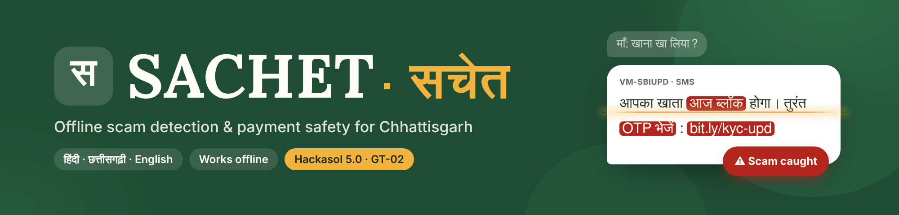
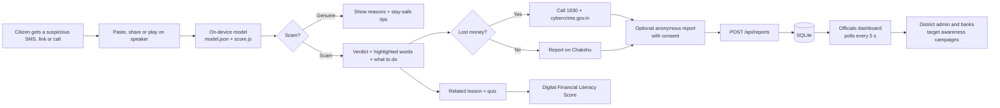
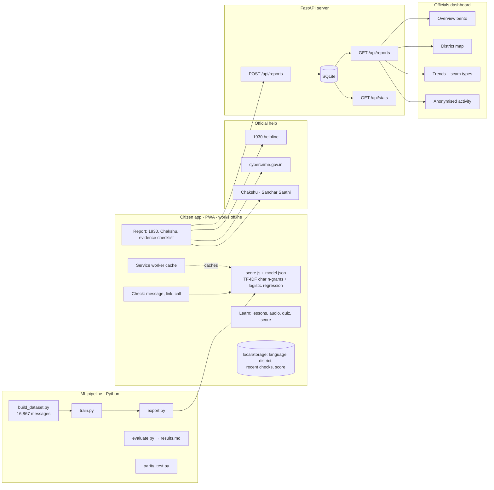

> **Note for judges:** the scam detector and the lessons are real and work offline. The reports on the officials' dashboard are demo data: each message is scored by the real model, but the district, channel, amount and scammer details are simulated. Detector accuracy is measured on our own held-out test split (see [Detector accuracy](#-detector-accuracy)).



<p align="center">
  <a href="https://sachet-pi.vercel.app">
    
  </a>
  <a href="#">
    
  </a>
  <a href="ml/results.md">
    
  </a>
</p>

<p align="center">
  <h1 align="center">SACHET · सचेत</h1>
</p>

SACHET is an offline, local-language platform that helps people in Chhattisgarh spot scam messages and calls, learn payment safety in Hindi and Chhattisgarhi, and reach the right official help fast, while giving district administration and banks a live view of where scams are spreading. *Built with React, FastAPI and a scikit-learn model that runs in the browser, for **Hackasol 5.0 · Track 5 Gov-Tech · GT-02: Cyber Fraud Detection & Digital Financial Literacy Platform**.*

> Created by [Prashant](https://github.com/Prashant-ARKM), Piyush, [Praptee](https://github.com/iammissmiller) & Pranay

## ■ Problem

First-time UPI users in villages and small towns are targeted by OTP scams, fake QR codes, phishing links and calls from fake bank staff or "police". Chhattisgarh has reported 1,301 cybercrime cases and about ₹107 crore lost in 18 months (assembly figures, 2025). Most safety help is in English, needs constant internet, and says little about where to report or how to share local scam patterns with banks and authorities.

## ■ Solution

- **Check:** paste or share an SMS, WhatsApp message or link, or play a call on speaker, and get *Scam* or *Genuine* with the reasons highlighted.
- **Report:** one tap to 1930 and cybercrime.gov.in if money was lost, or Chakshu (Sanchar Saathi) before any loss, with an evidence checklist and an anonymous report to the district.
- **Learn:** short visual and audio lessons with a quiz that gives a Digital Financial Literacy Score.
- **Dashboard:** anonymised counts of scam types by district, so banks and the district administration can target awareness campaigns.

## ■ Key Features

| Feature (problem statement) | What SACHET does |
|---|---|
| ML scam message detector | Trained TF-IDF + logistic-regression model (`model.json`) runs **in the browser, offline**. Handles English, Hindi (Devanagari) and Hinglish. Shows the words that drove the verdict and what to do next. |
| Scam call detector | Play a recorded call on speaker: the phone's speech engine writes it down, then the model checks the text on-device and flags scripts like fake KYC, "digital arrest" and fake courier calls. Speech-to-text needs internet on most phones; you can also type the conversation. |
| Official reporting handoff | "Did you lose money?" → one tap to **1930** + cybercrime.gov.in, or **Chakshu** before any loss. Evidence checklist. Optional anonymous report (with consent) sent to the dashboard. |
| Lessons + quiz | OTP, ATM PIN, UPI PIN and QR safety in Hindi, Chhattisgarhi and English, with audio. Quiz → Digital Financial Literacy Score. Works offline. |
| Scam-trend dashboard | District map of Chhattisgarh, rising districts (this week vs last), scam types, daily trend and an anonymised activity feed. Filters by district, type and time. |

**Also:**
- Installable PWA: the app, lessons and model are cached for offline use.
- Built for rural and elderly users: Hindi by default, large text and buttons on phones, a bottom bar with a red **Call 1930** button on every screen.
- One language choice (हिंदी / छत्तीसगढ़ी / English) carries across the launch page, citizen app and dashboard.

## ■ Detector accuracy

Evaluated **once** on a locked held-out test split, after the model was frozen. Messages are split by template group (`GroupShuffleSplit` on `template_id`), so near-duplicates never appear in both training and test.

| Metric (held-out test) | Value |
|---|---|
| Test messages | 3,586 (2,143 template groups) |
| Accuracy | **92.9%** |
| Scam precision | 89.1% |
| Scam recall | **96.3%** |
| Scam F1 | 0.926 |

| Language | Accuracy | Test messages |
|---|---|---|
| English | 98.1% | 1,915 |
| Hindi | 99.3% | 965 |
| Hinglish | 70.0% | 706 |

Full report, confusion matrix, dataset breakdown and known errors: [`ml/results.md`](ml/results.md). The Python model and the in-browser JavaScript scorer are checked against each other with a parity test (`ml/parity_test.py`).

## ■ UI Screenshots

<p align="center">
  
  <br><br>
  
  <br><br>
  
  <!-- TODO: add docs/readme/dashboard.png (officials dashboard screenshot) -->
</p>

## ■ End-to-End Flow



## ■ Architecture



## ■ Technical Snapshot

- **Frontend:** React 19, Vite 8, Tailwind CSS v4, React Router 7, vite-plugin-pwa (offline). Deployed on Vercel.
- **Charts and map:** ECharts and Leaflet with Chhattisgarh district boundaries.
- **Model:** scikit-learn TF-IDF character n-grams (2–5) + logistic regression, exported to JSON and scored in the browser with plain JavaScript. No internet or server needed to check a message.
- **Backend:** FastAPI + SQLite. Reports hold no victim data and no message text: only scam type, district, channel, amount lost, scammer phone/UPI/link, time and consent.
- **Languages:** Hindi, Chhattisgarhi and English across the UI, lessons and audio.

## ■ Repository Structure

```text
SACHET/
├── README.md
├── requirements.txt
├── frontend/                  # React + Vite PWA (citizen app + officials dashboard)
│   ├── public/
│   │   └── model.json         # exported detector, loaded in the browser
│   └── src/
│       ├── App.jsx            # routes: /, /citizen/*, /official/*
│       ├── LaunchPage.jsx
│       ├── ml/score.js        # in-browser model scoring
│       ├── citizen/           # Home, Check, Report, Learn + translations, lessons
│       ├── dashboard/         # Overview, Map, Trends, Scam types, Activity
│       └── shared/            # districts, scam types, loaders, shared UI
├── server/
│   ├── main.py                # FastAPI: /api/reports, /api/stats
│   └── seed_from_model.py     # demo reports scored by the real model
└── ml/
    ├── data/                  # messages.csv, splits.csv
    ├── build_dataset.py
    ├── train.py
    ├── export.py
    ├── evaluate.py
    ├── results.md             # held-out evaluation
    └── parity_test.py         # Python vs JavaScript scorer check
```

## ■ API Highlights

- `POST /api/reports` saves an anonymous report: `{ scam_type, district, channel, scammer: { phone, upi_id, url }, amount_lost, consent }`.
- `GET /api/reports?limit=` returns the latest reports for the dashboard (no scammer details in the list).
- `GET /api/stats?district=&type=` returns counts by scam type and district.

## ■ Run it locally

```bash
# 1. Frontend (citizen app + dashboard)
cd frontend
npm install
npm run dev                    # http://localhost:5173   (add -- --host to open it on your phone)

# 2. Server (optional: the dashboard shows sample data without it)
cd server
pip install -r requirements.txt
python seed_from_model.py      # fills the database with model-scored demo reports
uvicorn main:app --reload --port 8000

# 3. Model (optional: model.json is already included). Run from the repo root:
python ml/train.py && python ml/export.py && python ml/evaluate.py
python ml/parity_test.py       # Python vs in-browser scorer must match
```

For a deployed server, set `VITE_API_BASE` in the frontend and `SACHET_CORS_ORIGINS` on the server.

## 🔴 Submission Note

- **Demo data:** dashboard reports are scored by the real model, but districts, channels, amounts and scammer details are simulated.
- **Accuracy limits:** Hinglish is our weakest language (70.0%), and held-out messages come from the same sources as training, so accuracy on brand-new scam styles will be lower. See the disclosures in [`ml/results.md`](ml/results.md).
- **Call checking:** writing speech down uses the phone's speech engine, which needs internet on most phones. The scam check itself runs offline.
- **Not a government service:** SACHET links to official channels (1930, cybercrime.gov.in, Chakshu) but is a hackathon prototype, not an official app.

## ■ Team

* **Prashant** – Backend and machine learning
* **Piyush** – Backend and machine learning
* **Praptee** – Frontend (citizen app and officials dashboard)
* **Pranay** – Frontend (citizen app and officials dashboard)

---
<br>
<p align="center">
Built with 💚 for Chhattisgarh at Hackasol 5.0.
</p>