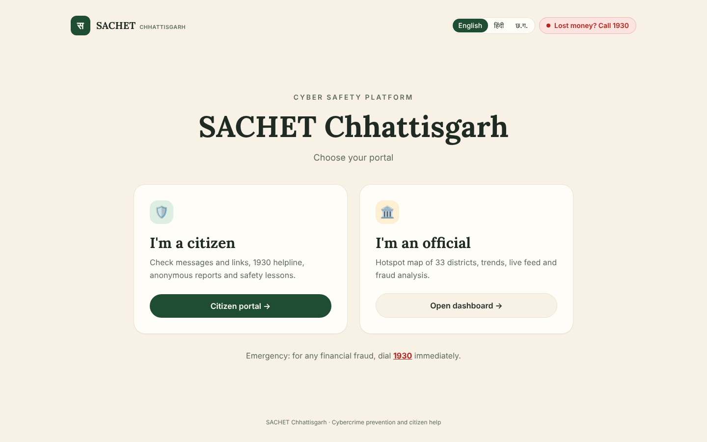
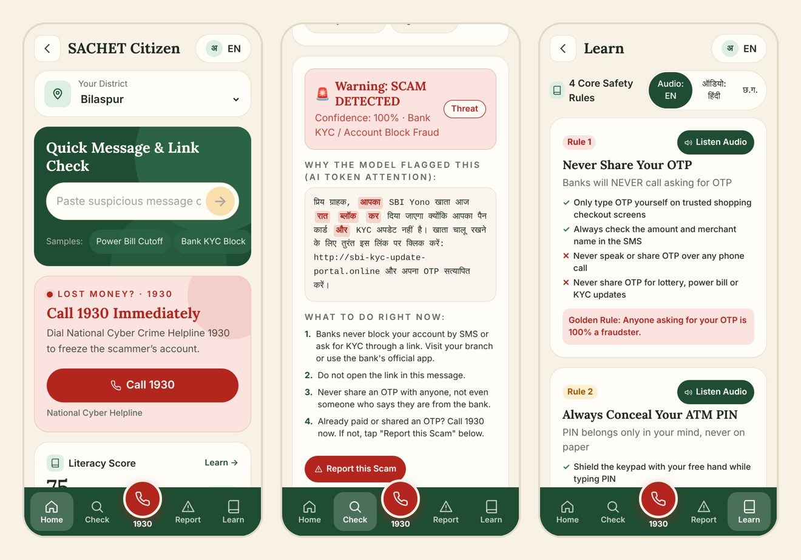
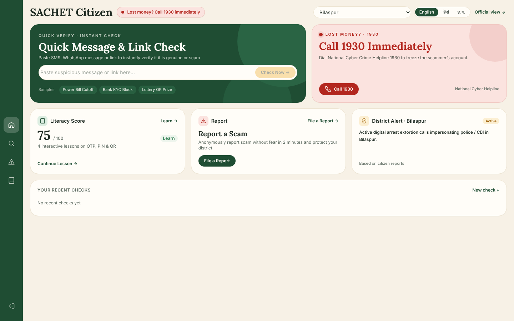
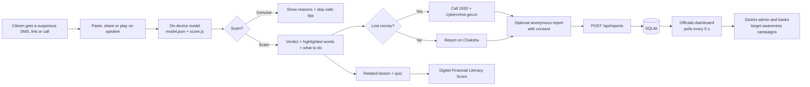
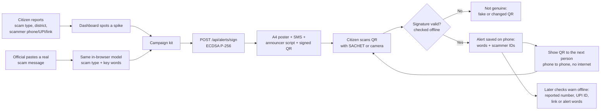
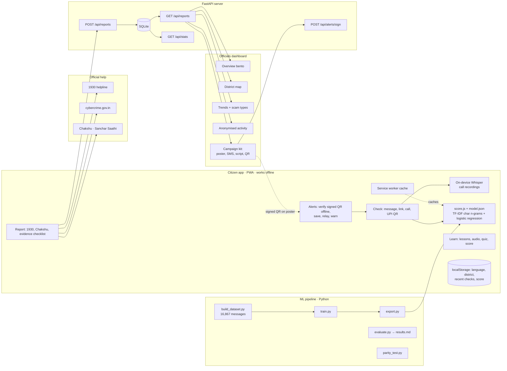

> **Note for judges:** the scam detector and the lessons are real and work offline. The reports on the officials' dashboard are demo data: each message is scored by the real model, but the district, channel, amount and scammer details are simulated. Detector accuracy is measured on our own held-out test split (see [Detector accuracy](#-detector-accuracy)). QR alerts show **"Demo signature"** unless the official signing key is configured (see [Campaign kit and signed QR alerts](#-campaign-kit-and-signed-qr-alerts)).


<p align="center">
  <a href="https://sachet-pi.vercel.app">
    
  </a>
  <a href="#">
    
  </a>
  <a href="ml/results.md">
    
  </a>
</p>

<p align="center">
  <h1 align="center">SACHET · सचेत</h1>
</p>

SACHET is an offline, local-language platform that helps people in Chhattisgarh spot scam messages and calls, learn payment safety in Hindi and Chhattisgarhi, and reach the right official help fast, while giving district administration and banks a live view of where scams are spreading. *Built with React, FastAPI and a scikit-learn model that runs in the browser, for **Hackasol 5.0 · Track 5 Gov-Tech · GT-02: Cyber Fraud Detection & Digital Financial Literacy Platform**.*

> Created by [Prashant](https://github.com/Prashant-ARKM), Piyush, [Praptee](https://github.com/iammissmiller) & Pranay

## ■ Problem

First-time UPI users in villages and small towns are targeted by OTP scams, fake QR codes, phishing links and calls from fake bank staff or "police". Chhattisgarh has reported 1,301 cybercrime cases and about ₹107 crore lost in 18 months (assembly figures, 2025). Most safety help is in English, needs constant internet, and says little about where to report or how to share local scam patterns with banks and authorities.

## ■ Solution

- **Check:** paste or share an SMS, WhatsApp message or link, play a call on speaker or upload a call recording, and get *Scam* or *Genuine* with the reasons highlighted. Scan a UPI QR to see who really gets the money before you pay.
- **Report:** one tap to 1930 and cybercrime.gov.in if money was lost, or Chakshu (Sanchar Saathi) before any loss, with an evidence checklist and an anonymous report to the district.
- **Learn:** short visual and audio lessons with a quiz that gives a Digital Financial Literacy Score.
- **Dashboard:** anonymised counts of scam types by district, so banks and the district administration can target awareness campaigns.
- **Campaign kit:** turn a scam spike into a ready poster, SMS and announcer script in minutes, in Hindi, Chhattisgarhi or English.
- **Signed QR alerts:** every poster carries a digitally signed QR. Citizens' phones verify it offline, pass it on phone to phone, and from then on warn about the scammer numbers and words it carries.

## ■ Key Features

| Feature (problem statement) | What SACHET does |
|---|---|
| ML scam message detector | Trained TF-IDF + logistic-regression model (`model.json`) runs **in the browser, offline**. Handles English, Hindi (Devanagari) and Hinglish. Shows the words that drove the verdict and what to do next. |
| Scam call detector | **Live:** play the call on speaker; the browser writes it down (needs internet) and the model re-checks the text every 1.5 s, warning *during* the call. **Recording:** upload an mp3/m4a/wav call recording; it is transcribed **on the phone** by Whisper (optional 80 MB *fast* or 250 MB *accurate* speech pack, downloaded once), in 30-second parts, and stops early once the scam is clear. Audio never leaves the phone. You can also type the conversation. |
| UPI QR check | Take a photo of any QR: SACHET shows the **real UPI ID and payee name**, any pre-filled amount or note, and red flags, and can **read the payee name aloud** (phone voice first; asks before using a cloud voice). Works offline. |
| Official reporting handoff | "Did you lose money?" → one tap to **1930** + cybercrime.gov.in, or **Chakshu** before any loss. Evidence checklist. Optional anonymous report (with consent) sent to the dashboard. |
| Lessons + quiz | OTP, ATM PIN, UPI PIN and QR safety in Hindi, Chhattisgarhi and English, with audio. Quiz → Digital Financial Literacy Score. Works offline. |
| Scam-trend dashboard | District map of Chhattisgarh that zooms into the selected district, with district, time, scam-type and sort filters and a table breakdown per district. Rising districts (this week vs last), scam types, daily trend and an anonymised activity feed. "Make campaign →" on rising-scam tiles. |
| Campaign kit (officials) | Pick a district and scam type, or **paste a real scam message**: the same in-browser model sets the scam type and picks the words to warn about. Generates an **A4 poster** (two styles, prints on one page), a **bulk SMS** with a Unicode SMS counter and a **30-second announcer script** with Play, in Hindi, Chhattisgarhi or English. Shows this week's reports vs last week as evidence. |
| Signed QR alerts | The poster QR is signed (ECDSA P-256) and carries the alert, the ML-picked words and up to 6 **reported scammer phone numbers, UPI IDs or links** the official approved. Phones **verify it offline**, catch tampered or fake posters, save it, and can **show the same QR to the next person** (relay). After that, Check warns offline when a message, call or payment QR contains a listed number or the alert's words. |
| Citizen Alerts page | Latest verified alert for your district, "Scan a poster" in three steps, and every alert saved on the phone. Also on the Home "District Alert" tile and in the bottom bar. |

**Also:**
- Installable PWA: the app, lessons and model are cached for offline use.
- Built for rural and elderly users: Hindi by default, large text and buttons on phones, a bottom bar with a red **Call 1930** button on every screen.
- One language choice (हिंदी / छत्तीसगढ़ी / English) carries across the launch page, citizen app and dashboard.
- Share target: on Android, share a message from any app straight into SACHET's Check screen.

## ■ Detector accuracy

Evaluated **once** on a locked held-out test split, after the model was frozen. Messages are split by template group (`GroupShuffleSplit` on `template_id`), so near-duplicates never appear in both training and test.

| Metric (held-out test) | Value |
|---|---|
| Test messages | 3,586 (2,143 template groups) |
| Accuracy | **92.9%** |
| Scam precision | 89.1% |
| Scam recall | **96.3%** |
| Scam F1 | 0.926 |

| Language | Accuracy | Test messages |
|---|---|---|
| English | 98.1% | 1,915 |
| Hindi | 99.3% | 965 |
| Hinglish | 70.0% | 706 |

Full report, confusion matrix, dataset breakdown and known errors: [`ml/results.md`](ml/results.md). The Python model and the in-browser JavaScript scorer are checked against each other with a parity test (`ml/parity_test.py`).

**Alert word-matching (smoke test).** With six saved sample alerts (KYC, OTP, digital arrest, loan app, fake QR, courier/customs), the citizen matcher flagged **3 of 1,926 held-out genuine messages (0.16%)** and **5 of 6 manually reworded scam examples (83.3%)**. These rates describe this small alert set and depend on the saved alerts and paraphrases. Fake QR and courier/customs alerts used the scam/not-scam model's weights because the scam-type model has no examples of them.

On the repository's Hinglish *development* split the model scores **99.29% (561 messages)**; the 70.0% above is the locked *test* split. Accuracy on real WhatsApp forwards is not yet measured.

## ■ UI Screenshots

<p align="center">
  
  <br><br>
  
  <br><br>
  
  <!-- TODO: add docs/readme/dashboard.png (officials dashboard screenshot) -->
</p>

## ■ End-to-End Flow



## ■ Campaign kit and signed QR alerts



- **What the QR holds:** district, scam type, issue and expiry date, an optional short quote of the real message, up to 5 ML-picked words and up to 6 approved scammer IDs with their report counts. Devanagari is packed to one byte per letter so the QR stays scannable. Format: [`docs/qr-alerts-backend.md`](docs/qr-alerts-backend.md).
- **How the words are picked:** for each word in the pasted message, the type model's weights for that scam type (minus the other types) rank the words that made the model say, for example, *digital arrest*. Generic words are dropped; the official can remove or add words.
- **Scammer IDs:** listed from citizen reports in that district over the last 30 days. IDs reported 2+ times are ticked by default; the official decides. Link shorteners count by their short code, and big platforms and `.gov.in` sites are never listed. The app always says *"reported N times"*, never *"confirmed scammer"*.
- **Signing:** the private key stays on the server (`ALERT_PRIVATE_KEY`); the server signs only for operators with the signing token. Phones verify with the public key (`VITE_ALERT_PUBLIC_KEY`) using Web Crypto, offline. Without the official key, alerts are signed with a public **demo key** and every screen says *"Demo signature"*, never *"from police"*.
- **Offline:** scanning inside the app, verifying, saving, relaying and the later warnings all work without internet once SACHET has been opened on the phone. A phone-camera scan opens `sachet-pi.vercel.app/a#…` and works offline only if SACHET was opened on that phone before.

## ■ Architecture



## ■ Technical Snapshot

- **Frontend:** React 19, Vite 8, Tailwind CSS v4, React Router 7, vite-plugin-pwa (offline). Deployed on Vercel.
- **Charts and map:** ECharts and Leaflet with Chhattisgarh district boundaries.
- **Model:** scikit-learn TF-IDF character n-grams (2–5) + logistic regression, exported to JSON and scored in the browser with plain JavaScript. No internet or server needed to check a message.
- **Speech:** browser speech recognition for live calls; Whisper (base / small) via Transformers.js in a Web Worker for recordings, WebGPU when available, otherwise WebAssembly. Text-to-speech uses the phone's own voices.
- **Signed alerts:** ECDSA P-256 / SHA-256. Server signs with the `cryptography` library; phones verify with Web Crypto. QR codes are generated in the browser (vendored qrcode-generator).
- **Backend:** FastAPI + SQLite. Reports hold no victim data and no message text: only scam type, district, channel, amount lost, scammer phone/UPI/link, time and consent.
- **Languages:** Hindi, Chhattisgarhi and English across the UI, lessons, audio, posters, SMS and announcer scripts.

## ■ Repository Structure

```text
SACHET/
├── README.md
├── requirements.txt
├── frontend/                  # React + Vite PWA (citizen app + officials dashboard)
│   ├── public/
│   │   └── model.json         # exported detector, loaded in the browser
│   └── src/
│       ├── App.jsx            # routes: /, /citizen/*, /official/*
│       ├── LaunchPage.jsx
│       ├── ml/score.js        # in-browser model scoring
│       ├── citizen/           # Home, Check, Report, Learn, Alerts + translations, lessons,
│       │                      #   QR check, on-device Whisper worker
│       ├── dashboard/         # Overview, Map, Trends, Scam types, Activity, Campaign kit
│       │                      #   (poster, SMS and script templates)
│       └── shared/            # districts, scam types, loaders, shared UI,
│                              #   alertSign.js (signed QR alerts), alertWords.js (ML word picking),
│                              #   QrCode.jsx + vendor/qrcode.mjs
├── docs/
│   └── qr-alerts-backend.md   # QR alert format, keys and signing setup
├── server/
│   ├── main.py                # FastAPI: /api/reports, /api/stats, /api/alerts/sign
│   └── seed_from_model.py     # demo reports scored by the real model
└── ml/
    ├── data/                  # messages.csv, splits.csv
    ├── build_dataset.py
    ├── train.py
    ├── export.py
    ├── evaluate.py
    ├── results.md             # held-out evaluation
    └── parity_test.py         # Python vs JavaScript scorer check
```

## ■ API Highlights

- `POST /api/reports` saves an anonymous report: `{ scam_type, district, channel, scammer: { phone, upi_id, url }, amount_lost, consent }`.
- `GET /api/reports?limit=` returns the latest reports for the dashboard (no scammer details in the list).
- `GET /api/stats?district=&type=` returns counts by scam type and district.
- `POST /api/alerts/sign` (needs `Authorization: Bearer <ALERT_SIGNING_TOKEN>`) signs a packed alert `{ payload }` and returns `{ signature }` (base64url, raw 64-byte ECDSA P-256).

## ■ Run it locally

```bash
# 1. Frontend (citizen app + dashboard)
cd frontend
npm install
npm run dev                    # http://localhost:5173   (add -- --host to open it on your phone)

# 2. Server (optional: the dashboard shows sample data without it)
cd server
pip install -r requirements.txt
python seed_from_model.py      # fills the database with model-scored demo reports
# optional: three controlled test numbers that may appear on demo posters
# python seed_from_model.py --demo-phones 7000000011 7000000012 7000000013
uvicorn main:app --reload --port 8000

# 3. Model (optional: model.json is already included). Run from the repo root:
python ml/train.py && python ml/export.py && python ml/evaluate.py
python ml/parity_test.py       # Python vs in-browser scorer must match
```

For a deployed server, set `VITE_API_BASE` in the frontend and `SACHET_CORS_ORIGINS` on the server.

**Official QR signing (optional):** server env `ALERT_PRIVATE_KEY` (P-256 PEM, never committed) and `ALERT_SIGNING_TOKEN`; frontend env `VITE_ALERT_PUBLIC_KEY`. Optional `VITE_PUBLIC_URL` sets the site address printed in QR codes (defaults to the deployed site, never `localhost`). Key script and steps: [`docs/qr-alerts-backend.md`](docs/qr-alerts-backend.md).

## 🔴 Submission Note

- **Demo data:** dashboard reports are scored by the real model, but districts, channels, amounts and scammer details are simulated.
- **Accuracy limits:** Hinglish is our weakest language (70.0%), and held-out messages come from the same sources as training, so accuracy on brand-new scam styles will be lower. See the disclosures in [`ml/results.md`](ml/results.md).
- **Call checking:** live listening uses the browser's speech service and needs internet. Uploaded recordings are transcribed on the phone and work offline after the speech pack is downloaded once (80 MB or 250 MB). The scam check itself always runs offline.
- **QR alerts:** without the official key configured, alerts use a public demo key and say *"Demo signature"*. Scammer IDs come from citizen reports approved by an official; they are shown as *"reported N times"*, not as confirmed. Alert-word matching only catches rewordings that reuse the alert's words.
- **Not a government service:** SACHET links to official channels (1930, cybercrime.gov.in, Chakshu) but is a hackathon prototype, not an official app.

## ■ Credits & Acknowledgements

SACHET is built on open-source software, open data and public services. Thank you to everyone behind them.

| Area | What we used |
|---|---|
| **Frontend** | [React](https://react.dev) · [React Router](https://reactrouter.com) · [Vite](https://vite.dev) · [Tailwind CSS](https://tailwindcss.com) · [vite-plugin-pwa](https://vite-pwa-org.netlify.app) (Workbox) · [idb](https://github.com/jakearchibald/idb) · [jsQR](https://github.com/cozmo/jsQR) · [qrcode-generator](https://github.com/kazuhikoarase/qrcode-generator) (MIT, vendored) · [Oxlint](https://oxc.rs) |
| **Charts and map** | [Apache ECharts](https://echarts.apache.org) + [echarts-for-react](https://github.com/hustcc/echarts-for-react) · [Leaflet](https://leafletjs.com) + [React Leaflet](https://react-leaflet.js.org) |
| **Backend** | [FastAPI](https://fastapi.tiangolo.com) · [Uvicorn](https://www.uvicorn.org) · [Pydantic](https://docs.pydantic.dev) · [SQLite](https://sqlite.org) · [cryptography](https://cryptography.io) (QR alert signing) |
| **On-device speech** | [Whisper](https://github.com/openai/whisper) (OpenAI, MIT) via [Transformers.js](https://huggingface.co/docs/transformers.js) (Hugging Face, Apache-2.0) and [ONNX Runtime Web](https://onnxruntime.ai) · speech packs `Xenova/whisper-base` and `Xenova/whisper-small` from the [Hugging Face Hub](https://huggingface.co) |
| **Machine learning** | [scikit-learn](https://scikit-learn.org) · [pandas](https://pandas.pydata.org) · [NumPy](https://numpy.org) · [SciPy](https://scipy.org) · [joblib](https://joblib.readthedocs.io) |
| **Fonts** | [Fraunces](https://fonts.google.com/specimen/Fraunces) and [Plus Jakarta Sans](https://fonts.google.com/specimen/Plus+Jakarta+Sans) via Google Fonts (SIL Open Font License) |
| **Map data** | Chhattisgarh district boundaries: LGD 2024 via [bharatlas](https://bharatlas.com/view/lgd_districts) ([CC BY 4.0](https://creativecommons.org/licenses/by/4.0/)), simplified |
| **Browser APIs** | Web Speech API: speech-to-text for live call checks, text-to-speech for lesson audio, QR payee names and announcer scripts · Web Crypto (offline QR alert signatures) · Web Workers and WebGPU / WebAssembly (on-device Whisper) · Web Share Target · Service Workers (offline) |
| **Data sources** | [Hugging Face](https://huggingface.co/datasets) and [Kaggle](https://www.kaggle.com/datasets) open datasets (see below) |
| **Design inspiration** | [Pinterest](https://www.pinterest.com) |
| **AI assistants** | Claude Opus 5.5 and Claude Sonnet 5.5 ([Anthropic](https://www.anthropic.com)) · Flash 3.5 · GPT Sol 6.2, used for coding help, design iteration and documentation |
| **Dev tools** | [VS Code](https://code.visualstudio.com) · [GitHub](https://github.com) |
| **Hosting and demo** | [Vercel](https://vercel.com) (frontend) · [Render](https://render.com) |
| **Docs** | [Mermaid](https://mermaid.js.org) diagrams · [shields.io](https://shields.io) badges |

**Training data:** open datasets from Hugging Face and Kaggle, plus our own templates. Names below are as recorded in `ml/data/messages_with_source.csv`; full details in [`ml/results.md`](ml/results.md).

- [SMS Spam Collection](https://archive.ics.uci.edu/dataset/228/sms+spam+collection), UCI Machine Learning Repository, by Tiago A. Almeida and José María Gómez Hidalgo (CC BY 4.0)
- `ysangam/Indian_Cyber_Scam_Hinglish` (Hugging Face)
- `Smishing_Dataset`, `Kaggle_Hindi_Merged`, `Indian_Telecom_SMS`, `indian-scam-sms-synthetic-audited`
- Synthetic and team-written templates (`Synthetic_Tier_C`, gap-fill rows), plus a few real contributed messages (`real_contributed.csv`)

<!-- TODO (ML team): add source links and licences for each dataset above -->

**Official services we link to:** National Cyber Crime Helpline **1930** and [cybercrime.gov.in](https://cybercrime.gov.in) (Indian Cyber Crime Coordination Centre, MHA) · [Chakshu on Sanchar Saathi](https://sancharsaathi.gov.in) (Department of Telecommunications). SACHET is not affiliated with them.

## ■ Team

* **Prashant** – Backend and machine learning
* **Piyush** – Backend and machine learning
* **Praptee** – Frontend (citizen app and officials dashboard)
* **Pranay** – Frontend (citizen app and officials dashboard)

---
<br>
<p align="center">
Built with 💚 for Chhattisgarh at Hackasol 5.0.
</p>
### Campaign alert word-match smoke test

With the existing model and six saved sample alerts (KYC, OTP, digital arrest,
loan app, fake QR, and courier/customs), the citizen matcher flagged **3 of
1,926 held-out genuine messages (0.16%)** and **5 of 6 manually reworded scam
examples (83.3%)**. These rates describe this small alert set and depend on the
saved alerts and paraphrases. The fake QR and courier/customs alerts used the
binary model's keyword weights because the type model has no rows for them.

The existing model scored **99.29% on 561 Hinglish development messages**
(model only, repository split). Real WhatsApp-forward accuracy remains unmeasured.
